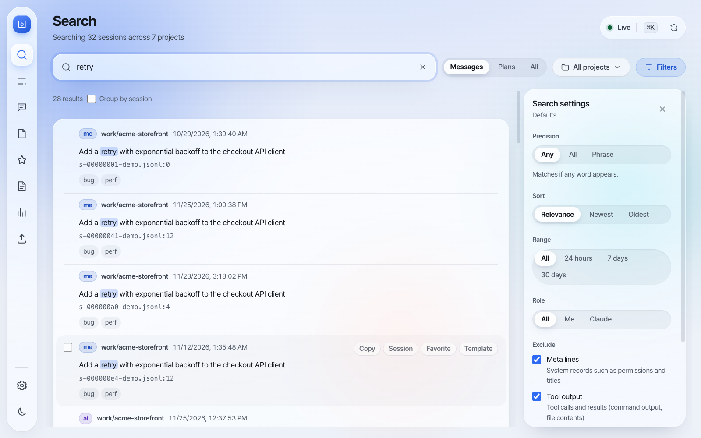
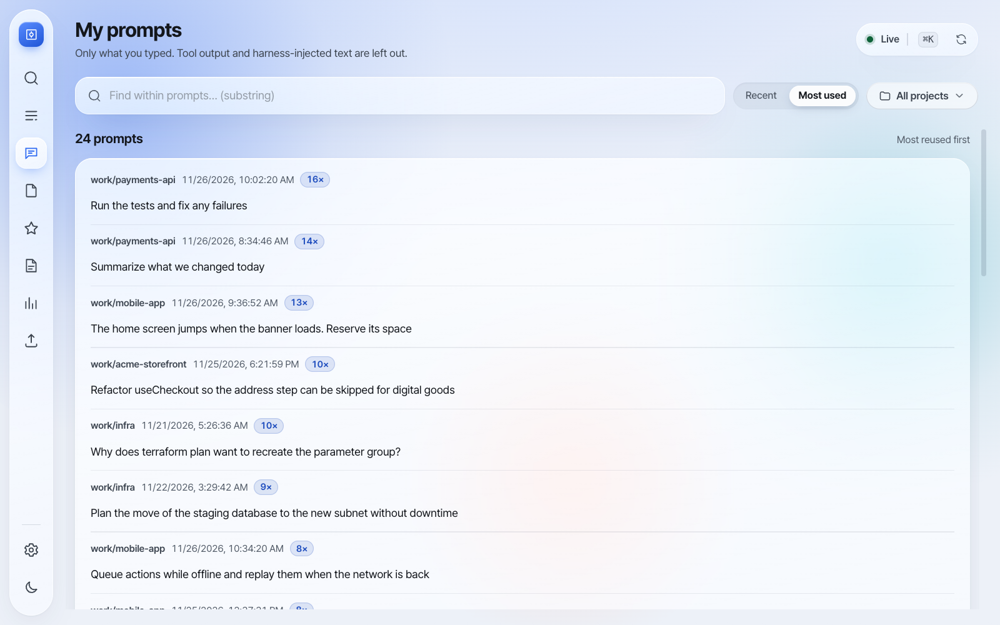
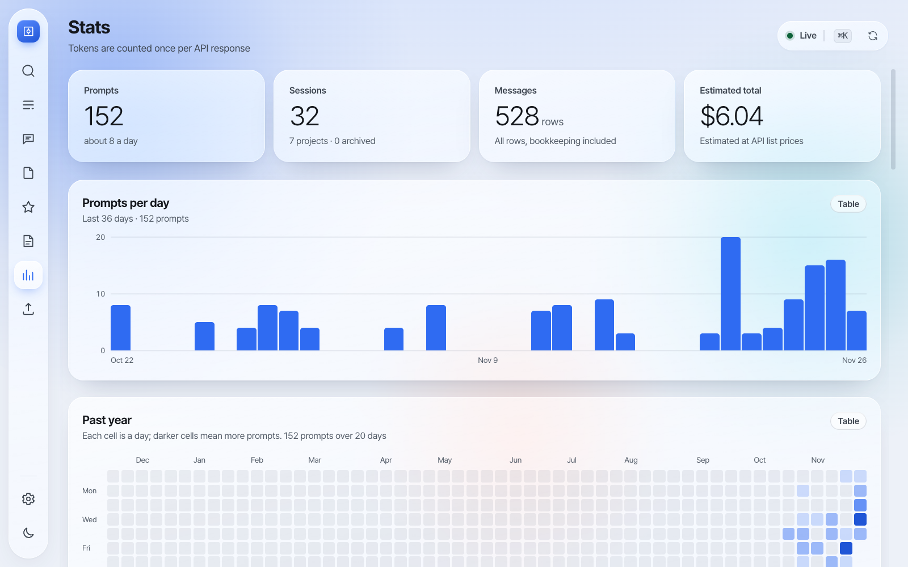
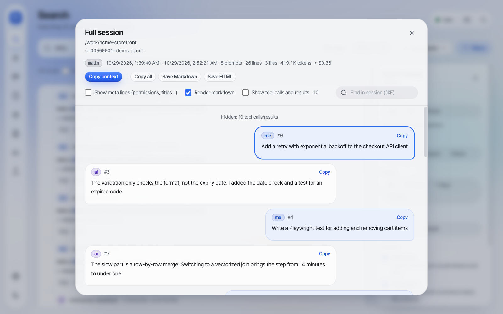
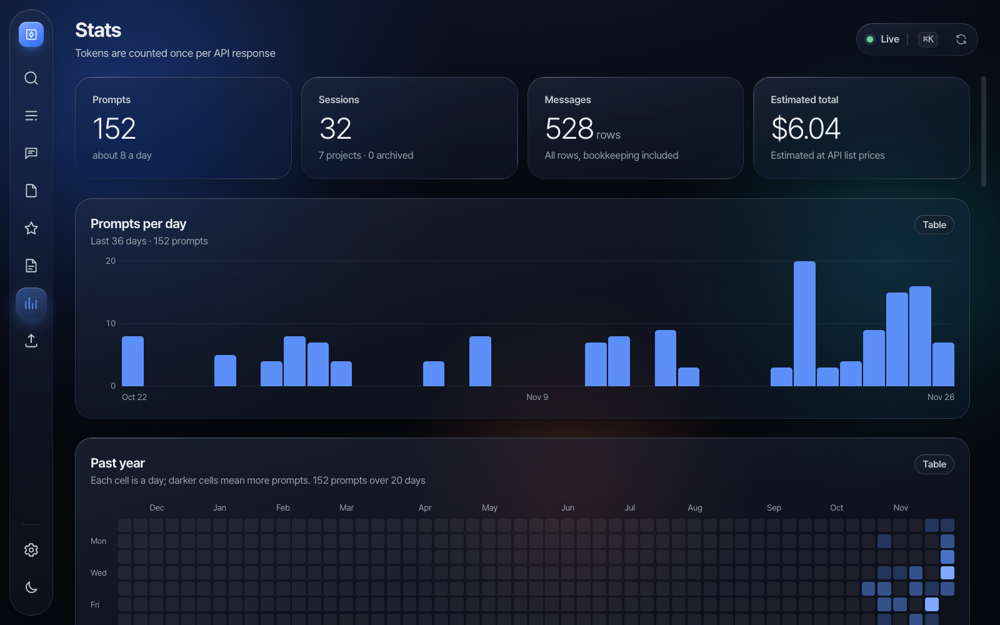
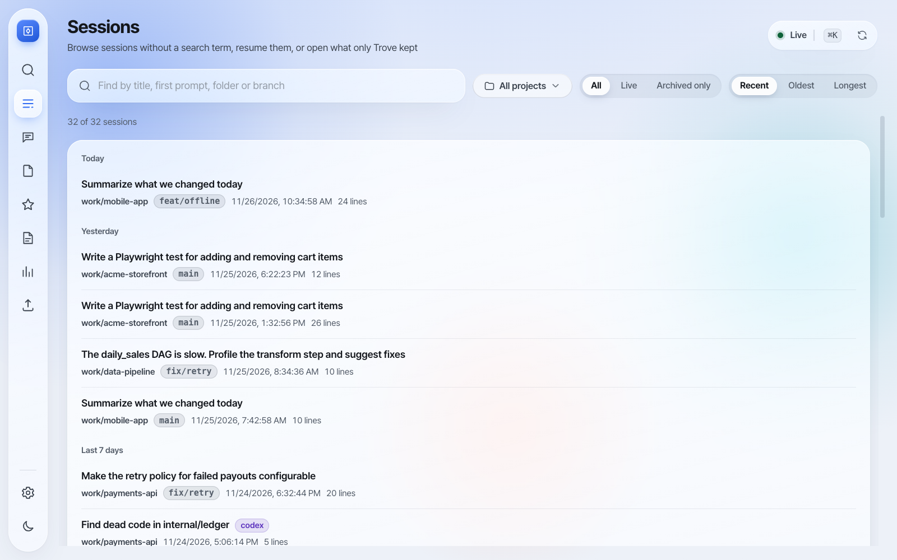
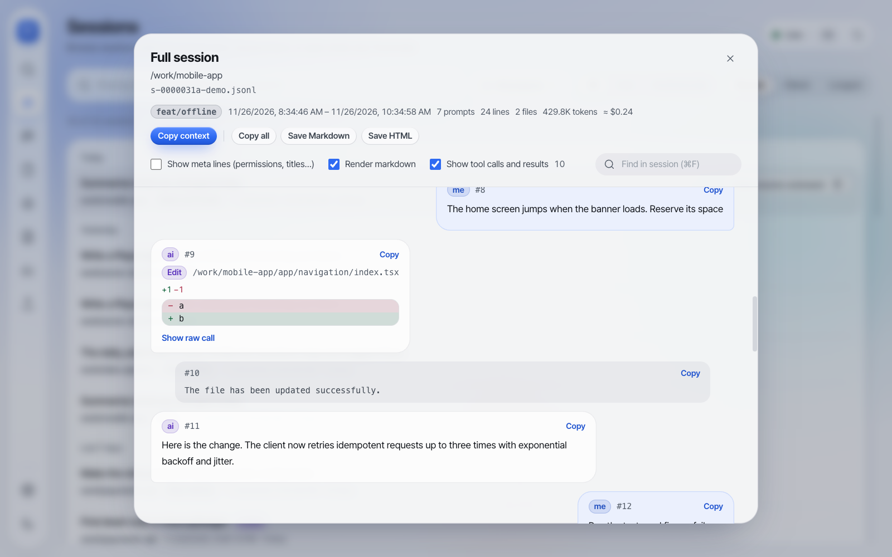

<p align="center"></p>

# Trove

[English](README.md) · **한국어** · [日本語](README.ja.md) · [简体中文](README.zh-CN.md)

> 이 문서는 영어 [README](README.md)를 번역한 거예요. 내용이 다르면 영어판이 기준이에요.

**Trove**는 [Claude Code](https://www.anthropic.com/claude-code) 대화 기록을 내 컴퓨터에서 보관하고 검색하는 데스크톱 앱이에요.
- 대화를 색인하고, Claude Code가 오래된 대화 파일을 지운 뒤에도 사본을 남겨요.
- 모든 기록을 밀리초 단위로 검색하고(SQLite FTS5), 내가 쓴 프롬프트를 다시 찾아 쓸 수 있어요.

[](https://github.com/RosieOh/trove/releases)
[](https://github.com/RosieOh/trove/actions/workflows/ci.yml)
[](LICENSE)

**[macOS(Apple Silicon / Intel)·Windows·Linux용 내려받기 →](https://github.com/RosieOh/trove/releases)**

<picture>
  <source media="(prefers-color-scheme: dark)" srcset="docs/images/search-dark.png">
  
</picture>

- **개인정보**
  - Claude 파일은 읽기만 해요. `~/.claude/` 아래에는 아무것도 쓰지 않아요.
  - 색인과 백업은 사용자 데이터 폴더의 로컬 SQLite DB에 저장돼요.
  - Trove가 실제로 쓸모 있는지 재려고, 앱을 연 *날짜*만(시각·내용 없이) 같은 DB에 남겨 통계 탭에 보여 줘요. 밖으로는 아무것도 보내지 않아요.
  - 네트워크 요청은 GitHub Releases에 새 버전이 있는지 묻는 업데이트 확인 하나뿐이에요. 대화 내용은 보내지 않고, **설정**에서 끌 수 있어요([ADR-0005](docs/decisions/0005-update-check-network-exception.md)).
- **지원 플랫폼:** 주 대상은 macOS(Apple Silicon, Intel)예요. Windows와 Linux 빌드도 CI에서 같은 E2E 테스트를 통과하지만, 실제 사용 경험은 적어요.
- **앱 언어:** 한국어와 영어를 지원해요(설정에서 전환).
- **라이선스:** MIT. [LICENSE](LICENSE)를 보세요.

## 설치

[Releases](https://github.com/RosieOh/trove/releases)에서 내 시스템에 맞는 파일을 내려받으세요. 아직 **코드 서명이 없어서** 처음 실행할 때 한 번 더 확인해야 해요.

**macOS:** `Trove-<버전>-mac-arm64.dmg`(Apple Silicon) 또는 `…-mac-x64.dmg`(Intel).

1. DMG를 열고 **Trove**를 응용 프로그램 폴더로 끌어다 놓으세요.
2. 한 번 실행하면 macOS가 개발자를 확인할 수 없다고 해요. **완료**를 누르세요.
3. **시스템 설정 → 개인정보 보호 및 보안**에서 「"Trove"이(가) 차단되었습니다」 옆의 **그래도 열기**를 누르세요. macOS 14 이하에서는 앱을 오른쪽 클릭하고 **열기**를 고르면 돼요.
4. 터미널을 쓴다면 `xattr -dr com.apple.quarantine "/Applications/Trove.app"`도 돼요.

서명 없는 macOS 빌드는 스스로 업데이트하지 못해요. 새 버전은 Releases 페이지에서 받으세요.

**Windows:** `Trove-<버전>-win-x64.exe`를 실행하세요. SmartScreen이 「Windows의 PC 보호」를 띄우면 **추가 정보 → 실행**을 누르세요. 현재 사용자 계정에 설치돼요.

**Linux:** 두 패키지 중 하나를 쓰세요.
- AppImage: `chmod +x Trove-*.AppImage && ./Trove-*.AppImage`
- Debian/Ubuntu: `sudo apt install ./Trove-*.deb`

**처음 실행할 때:**
- Trove는 `~/.claude/projects`와 `~/.claude/plans`를 읽어요. Codex CLI를 쓴다면 `~/.codex/sessions`도 읽어요.
- 색인은 백그라운드 스레드에서 돌아서 창이 멈추지 않아요. 5GB 기록은 약 1분 걸리고, 그 뒤로는 새로 추가된 줄만 읽어요.
- 다른 위치를 읽게 하려면 `CLAUDE_HOME` / `CODEX_HOME`에 절대 경로를 지정하세요.

## 스크린샷

| 내 프롬프트: 직접 입력한 것만, 많이 쓴 순 | 통계: API 응답당 한 번 센 토큰, 비용, Trove를 연 날 |
|---|---|
|  |  |
| **전체 세션**: 대화 전체, 도구 출력은 접힘 | **다크 테마** |
|  |  |
| **세션**: 모든 세션을 최신순으로, 한 번에 이어가기 | 도구가 고친 내용의 **변경 비교** |
|  |  |

스크린샷은 가상의 데모 기록(`scripts/demo-corpus.mjs`)으로 찍었어요. `npx vite build && node scripts/screenshots.mjs`로 다시 만들 수 있어요.

## 기능

| 영역 | 상태 |
|------|------|
| `~/.claude/projects`(루트 `{uuid}.jsonl`, `subagents/`, `agent-transcripts/`, `sessions-index.json`)와 `~/.claude/plans` 색인 | 지원 — 추가분만 읽음, 백그라운드 워커 |
| **보관**: Claude Code가 지운 세션도 계속 검색됨(「보관됨」 표시). 삭제는 직접 해야만 됨 | 지원(기본값 켬) |
| 전문 검색 + 프로젝트·역할·기간·메타·서브에이전트·**도구 출력**·**태그** 필터 | 지원 |
| 검색 방식(OR / AND / 구문), 정렬(관련도 / 최신 / 오래된), 단어 중간·한중일 문자는 부분 일치로 다시 찾기 | 지원 |
| **내 프롬프트**: 직접 입력한 것만, 중복 제거, 최근 순 또는 많이 쓴 순 | 지원 |
| **파일**: 어떤 세션이 언제, 어느 브랜치에서 그 파일을 건드렸는지 | 지원 |
| 다시 색인하거나 업그레이드해도 사라지지 않는 즐겨찾기·태그 | 지원 |
| 세션 대화록 창(마크다운, 메타·도구 표시 전환, 보관됨 안내) | 지원 |
| `{{변수}}`가 들어가는 프롬프트 템플릿 | 지원 |
| 명령 팔레트(⌘/Ctrl+K), 키보드로 결과 이동 | 지원 |
| 통계: 주별로 Trove를 연 날(로드맵의 계속/중단 판단 기준) | 지원 |
| 모델별 사용량을 **API 응답당 한 번** 집계, 5분·1시간 캐시 쓰기를 반영한 비용 추정과 기준일이 적힌 편집 가능한 단가표(Claude와 Codex가 쓰는 OpenAI 모델) | 지원 |
| Markdown / CSV 내보내기 — 복사 또는 파일로 저장 | 지원 |
| **백업**: 매일 DB 스냅숏, 업그레이드·보관본 삭제·복원 직전에도 하나씩. 설정에서 복원. 열리지 않는 DB는 최신 백업으로 자동 복구 | 지원(3개 보관) |
| 설정: 보관 방식, 백업, 업데이트 확인, 데이터 위치, 전체 다시 읽기 | 지원 |
| **Claude Code 연결(MCP)**: Claude Code가 지운 세션까지 Claude Code에서 직접 찾아볼 수 있는 읽기 전용 로컬 서버(설정에 `claude mcp add` 명령) | 지원 |
| **세션**: 프로젝트별 전체 세션, 최근·오래된·긴 순, 보관본만 보기, `/rename`이나 Claude Code가 붙인 제목, 날짜 묶음과 키보드 이동 | 지원 |
| **이어가기**: `claude --resume`(또는 `--fork-session`) 명령 복사, 이어갈 수 없는 세션은 새 세션용 맥락 복사 | 지원 |
| 세션 화면: 줄 수 제한 없이 나눠 불러오기, 세션 안에서 찾기(⌘F), 토큰과 비용, 서브에이전트 연결, Markdown·HTML 저장 | 지원 |
| 도구가 고친 파일의 **변경 비교(diff)**: 세션 화면과 파일 탭 | 지원 |
| 검색창 필터: `project:` `branch:` `role:` `tag:` `after:` `before:` `is:archived` `/정규식/`, 세션별 묶기, 결과 더 보기 | 지원 |
| 복사·내보내기(그리고 MCP 결과)에서 **비밀값 가리기**, 기본으로 켜짐 | 지원 |
| 전역 단축키, 보관 알림 | 지원(단축키는 기본으로 꺼짐) |
| 통계: 1년 활동, 요일×시간대, 프로젝트별 비용, 도구 사용과 실패 비율, 5시간 블록 | 지원 |
| Codex CLI 세션(`~/.codex/sessions`, 작업 폴더별로 묶음) | 최선 노력 |
| 한국어 / 영어 UI, 라이트 / 다크 테마 | 지원 |

## 문서

[docs/](docs/README.md) 폴더를 보세요(PRD, 아키텍처, ADR, 로드맵, 릴리스 절차). 문서는 영어로 되어 있어요.

[CHANGELOG.md](CHANGELOG.md) — 버전마다 바뀐 점.

## 개발

```bash
npm install
npm run dev
```

개발하면서 DevTools를 자동으로 열려면 다음 명령을 쓰세요. Chromium이 해롭지 않은 로그를 터미널에 조금 남겨요.

```bash
VAULT_OPEN_DEVTOOLS=1 npm run dev
```

그 밖에는 **보기 → 개발자 도구** 메뉴나 macOS의 **⌥⌘I**로 열 수 있어요. VS Code 터미널이나 에이전트에서 실행할 때는 먼저 `ELECTRON_RUN_AS_NODE`를 해제하세요(`env -u ELECTRON_RUN_AS_NODE npm run dev`).

다른 스크립트:

- `npm run build` — 타입 검사, Vite 프로덕션 빌드, `electron-builder`로 설치 파일 생성
- `npm run typecheck` — main/preload/shared와 렌더러 타입 검사
- `npm run lint` — ESLint(flat config)
- `npm test` — 단위 테스트(파서, 검색 도우미, 단가, IPC 입력 검사)
- `npm run test:db` — SQLite 통합 테스트(색인, 보관, 마이그레이션, 검색, 백업)
- `npm run test:e2e` — E2E 스모크 테스트. 빌드한 앱(먼저 `npx vite build`)을 픽스처 대화 기록으로 띄워 Playwright로 조작해요
- `npm run bench -- <vault.db>` — 기존 색인에서 검색 지연 시간 측정
- `npm run poc` — 대화 기록을 스캔해 파서 통계를 보여 주는 CLI(GUI·DB 없음)

환경 변수: `CLAUDE_HOME`, `CODEX_HOME`(절대 경로), `VAULT_USER_DATA`(색인 DB를 지워도 되는 곳에 두기), `VAULT_DISABLE_UPDATER=1`.

CI(GitHub Actions)는 푸시와 PR마다 다음을 실행해요.
- 타입 검사, 린트, 단위 테스트, DB 통합 테스트, 렌더러 빌드
- macOS·Windows·Linux에서 E2E 스모크 테스트

## 기여

[CONTRIBUTING.md](CONTRIBUTING.md)를 읽어 주세요. 버그 제보와 아이디어는 **GitHub Issues**에, 오래 남길 결정은 `docs/decisions/`나 [docs/issue-decisions.md](docs/issue-decisions.md)에 남겨요.

## 고지

Trove는 독립 오픈소스 도구예요.
- Anthropic과 제휴 관계가 없고 Anthropic의 보증도 받지 않았어요. 「Claude」와 「Claude Code」는 Anthropic의 상표이고, 여기서는 이 앱이 무엇과 함께 쓰이는지 설명할 때만 써요.
- 앱은 Claude Code가 이미 내 컴퓨터에 저장해 둔 파일만 읽어요. 업무 저장소를 색인할 때는 소속 조직의 보안 정책을 지켜 주세요.
- 비용은 기록된 토큰 수와 사용자가 고칠 수 있는 단가표로 계산한 추정치예요. 실제 청구 금액이 아니에요.
