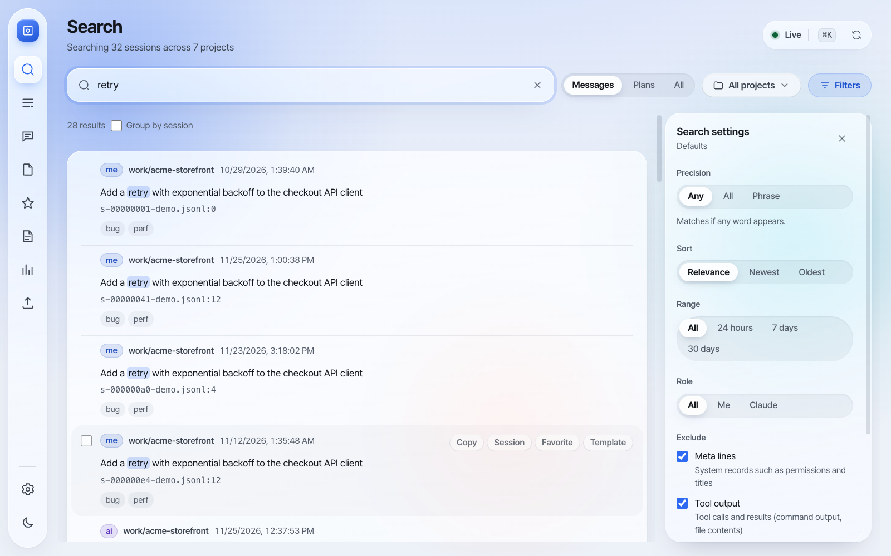
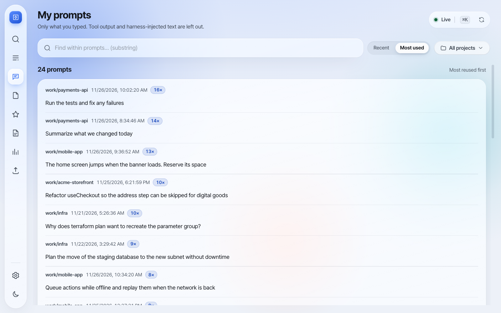
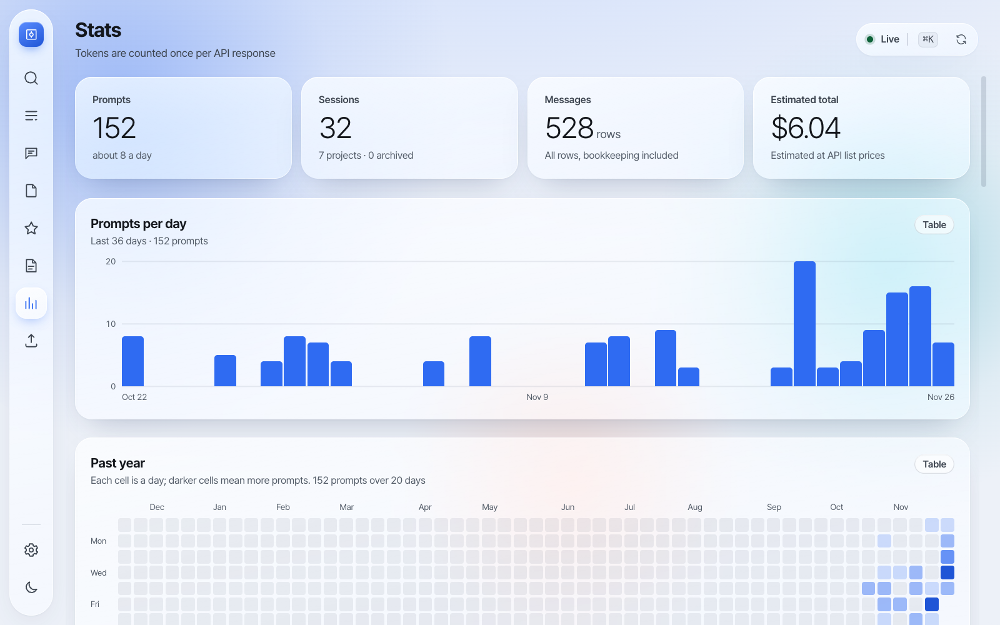
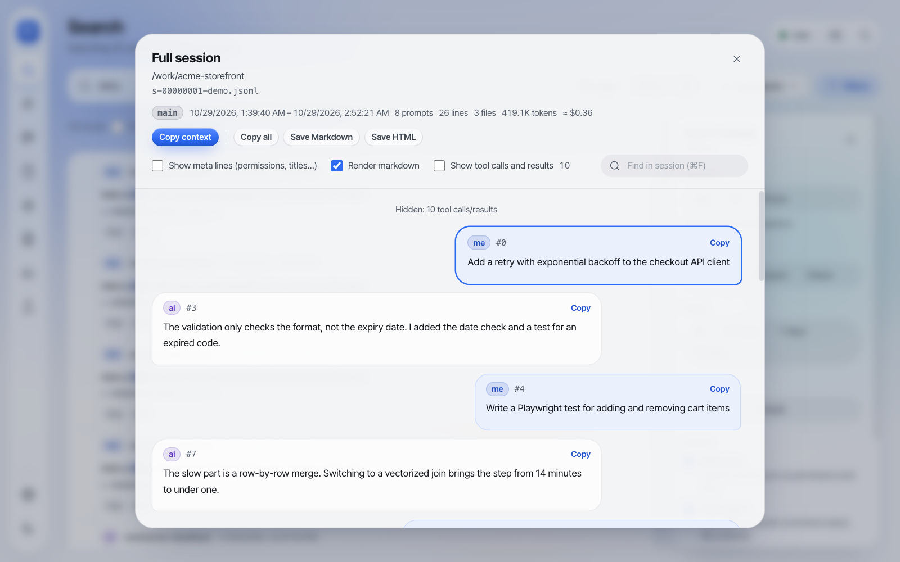
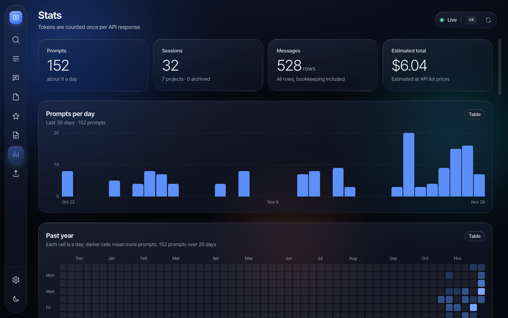
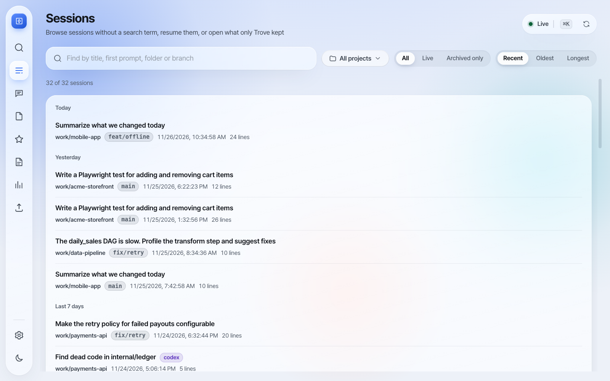
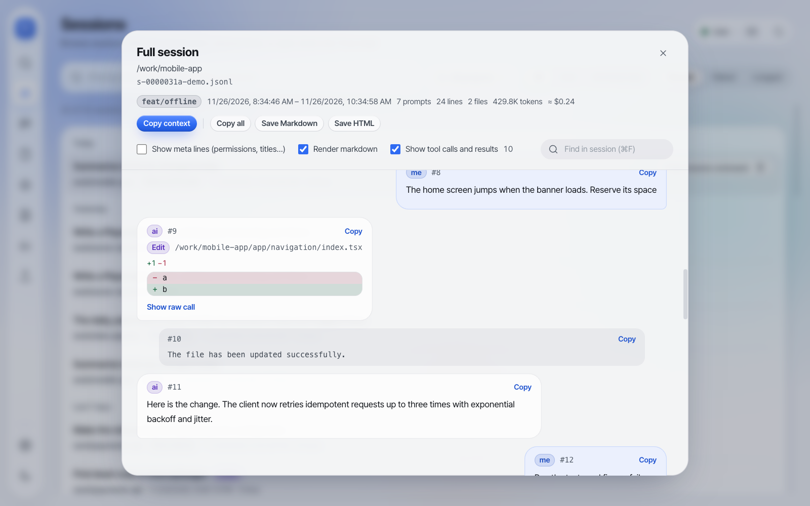

<p align="center"></p>

# Trove

**English** · [한국어](README.ko.md) · [日本語](README.ja.md) · [简体中文](README.zh-CN.md)

**Trove** is a local-first desktop app for your [Claude Code](https://www.anthropic.com/claude-code) history. It indexes your conversations and keeps them even after Claude Code deletes old transcripts. Everything is searchable in milliseconds (SQLite FTS5), and you can find and reuse your own prompts.

[](https://github.com/RosieOh/trove/releases)
[](https://github.com/RosieOh/trove/actions/workflows/ci.yml)
[](LICENSE)

**[Download for macOS (Apple Silicon / Intel), Windows or Linux →](https://github.com/RosieOh/trove/releases)**

<picture>
  <source media="(prefers-color-scheme: dark)" srcset="docs/images/search-dark.png">
  
</picture>

- **Privacy.**
  - Claude's files are read-only: the app never writes under `~/.claude/`.
  - The index and its backups live in a local SQLite DB under your user data directory.
  - To measure its own usefulness, Trove records the *dates* you opened it (no times, no content) in that DB for the Stats tab. Nothing leaves the machine.
  - The only network request is an update check against GitHub Releases. It sends no conversation data and can be turned off in **Settings** ([ADR-0005](docs/decisions/0005-update-check-network-exception.md)).
- **Platforms.** macOS (Apple Silicon and Intel) is the primary target. Windows and Linux builds pass the same end-to-end test in CI but see less day-to-day use.
- **License.** MIT, see [LICENSE](LICENSE).

## Install

Download the file for your system from [Releases](https://github.com/RosieOh/trove/releases). The builds are **not code-signed yet**, so the first launch needs one extra confirmation.

**macOS:** `Trove-<version>-mac-arm64.dmg` (Apple Silicon) or `…-mac-x64.dmg` (Intel).

1. Open the DMG and drag **Trove** to Applications.
2. Open it once. macOS says it cannot verify the developer; click **Done**.
3. Go to **System Settings → Privacy & Security**, scroll to "Trove was blocked…" and click **Open Anyway**. On macOS 14 and earlier, right-click the app and choose **Open** instead.
4. Alternatively, in a terminal: `xattr -dr com.apple.quarantine "/Applications/Trove.app"`.

Unsigned macOS builds cannot update themselves; new versions appear on the Releases page.

**Windows:** run `Trove-<version>-win-x64.exe`. If SmartScreen says "Windows protected your PC", choose **More info → Run anyway**. It installs for the current user.

**Linux:** use either package.
- AppImage: `chmod +x Trove-*.AppImage && ./Trove-*.AppImage`.
- Debian/Ubuntu: `sudo apt install ./Trove-*.deb`.

**First run.** Trove reads `~/.claude/projects` and `~/.claude/plans` (and `~/.codex/sessions` if you use Codex CLI) and indexes them on a background thread, so the window stays responsive. A 5 GB history takes about a minute; after that only new lines are read. To point it elsewhere, set `CLAUDE_HOME` / `CODEX_HOME` to absolute paths.

## Screenshots

| My prompts: what you typed, most used first | Stats: tokens once per API response, cost, days you used Trove |
|---|---|
|  |  |
| **Full session**: the whole conversation, tool output folded | **Dark theme** |
|  |  |
| **Sessions**: every session, newest first; resume in one click | **Diffs** of the edits tools made |
|  |  |

The screenshots use a synthetic demo history (`scripts/demo-corpus.mjs`); regenerate them with `npx vite build && node scripts/screenshots.mjs`.

## Features

| Area | Status |
|------|--------|
| Indexing of `~/.claude/projects` (root `{uuid}.jsonl`, `subagents/`, `agent-transcripts/`, `sessions-index.json`) and `~/.claude/plans` | Yes — append-only, on a background worker |
| **Archive**: sessions Claude Code deletes stay searchable (badged "Archived"); purge is explicit | Yes (default on) |
| Full-text search + project / role / date / meta / subagents / **tool output** / **tag** filters | Yes |
| Match modes (OR / AND / phrase), sort (relevance / newest / oldest), substring fallback for infix & CJK | Yes |
| **My prompts**: what you typed, deduplicated, recent or most used | Yes |
| **Files**: which sessions touched a file, when, on which branch | Yes |
| Favorites and tags that survive re-indexing and upgrades | Yes |
| Session transcript modal (markdown, meta/tool toggles, archived banner) | Yes |
| Prompt templates with `{{variables}}` | Yes |
| Command palette (⌘/Ctrl+K), keyboard result navigation | Yes |
| Stats: days you opened Trove per week (the roadmap's go/no-go measure) | Yes |
| Usage stats per model, counted **once per API response**; cost estimate with 5-minute / 1-hour cache writes and an editable, dated price table (Claude and the OpenAI models Codex uses) | Yes |
| Export Markdown / CSV — copy or save to a file | Yes |
| **Backups**: daily DB snapshots plus one before upgrades, purges and restores; restore in Settings; a DB that won't open is recovered from the newest backup | Yes (keeps 3) |
| Settings: archive mode, backups, update checks, data location, full re-read | Yes |
| **Claude Code connection (MCP)**: a local, read-only stdio server so Claude Code can search your history, archived sessions included (`claude mcp add` line in Settings) | Yes |
| **Sessions**: every session by project, newest / oldest / longest, archived only; titles from `/rename` or Claude Code; date groups and keyboard navigation | Yes |
| **Resume**: copy `claude --resume` (or `--fork-session`); for a session that can no longer be resumed, copy a context brief for a new one | Yes |
| Session view: windowed loading (no line limit), find in session (⌘F), tokens and cost, subagent links, save as Markdown / HTML | Yes |
| **Diffs** of tool edits in the session view and the Files tab | Yes |
| Search operators: `project:` `branch:` `role:` `tag:` `after:` `before:` `is:archived` `/regex/`; group by session; load more | Yes |
| **Secret masking** in copied and exported text (and MCP results), on by default | Yes |
| Global shortcut, archive notifications | Yes (shortcut off by default) |
| Stats: year heatmap, weekday × hour, cost by project, tool usage and error rate, 5-hour blocks | Yes |
| Codex CLI sessions (`~/.codex/sessions`, grouped by working directory) | Best effort |
| Korean / English UI, light / dark theme | Yes |

## Documentation

See the [docs/](docs/README.md) directory (PRD, architecture, ADRs, roadmap, release process).

[CHANGELOG.md](CHANGELOG.md) — what changed in each version.

## Development

```bash
npm install
npm run dev
```

To open DevTools automatically while developing (Chromium logs some harmless noise to the terminal):

```bash
VAULT_OPEN_DEVTOOLS=1 npm run dev
```

Otherwise open them from **View → Developer Tools** or **⌥⌘I** on macOS. When running from a VS Code terminal or agent, unset `ELECTRON_RUN_AS_NODE` first (`env -u ELECTRON_RUN_AS_NODE npm run dev`).

Other scripts:

- `npm run build` — typecheck, production Vite build, installer via `electron-builder`.
- `npm run typecheck` — main/preload/shared and the renderer.
- `npm run lint` — ESLint (flat config).
- `npm test` — unit tests (parsers, search helpers, pricing, IPC guards).
- `npm run test:db` — SQLite integration tests (indexing, archive, migrations, search, backups).
- `npm run test:e2e` — end-to-end smoke test: launches the built app (`npx vite build` first) against fixture transcripts and drives it with Playwright.
- `npm run bench -- <vault.db>` — search latency on an existing index.
- `npm run poc` — CLI scan of your transcripts with parser stats (no GUI, no DB).

Environment overrides: `CLAUDE_HOME`, `CODEX_HOME` (absolute paths), `VAULT_USER_DATA` (put the vault DB somewhere disposable), `VAULT_DISABLE_UPDATER=1`.

CI (GitHub Actions) runs typecheck, lint, unit tests, DB integration tests and the renderer build, plus the end-to-end smoke test on macOS, Windows and Linux, on every push/PR.

## Contributing

Read [CONTRIBUTING.md](CONTRIBUTING.md). Bug reports and ideas go to **GitHub Issues**; durable decisions go to `docs/decisions/` or [docs/issue-decisions.md](docs/issue-decisions.md).

## Disclaimer

This is an independent open-source tool. It is not affiliated with or endorsed by Anthropic; "Claude" and "Claude Code" are Anthropic's trademarks, used here only to say what the app works with. It reads files already stored on your machine by Claude Code; respect your own security policies when indexing work repositories. Cost figures are estimates from logged token counts and a user-editable price table, not billing data.
