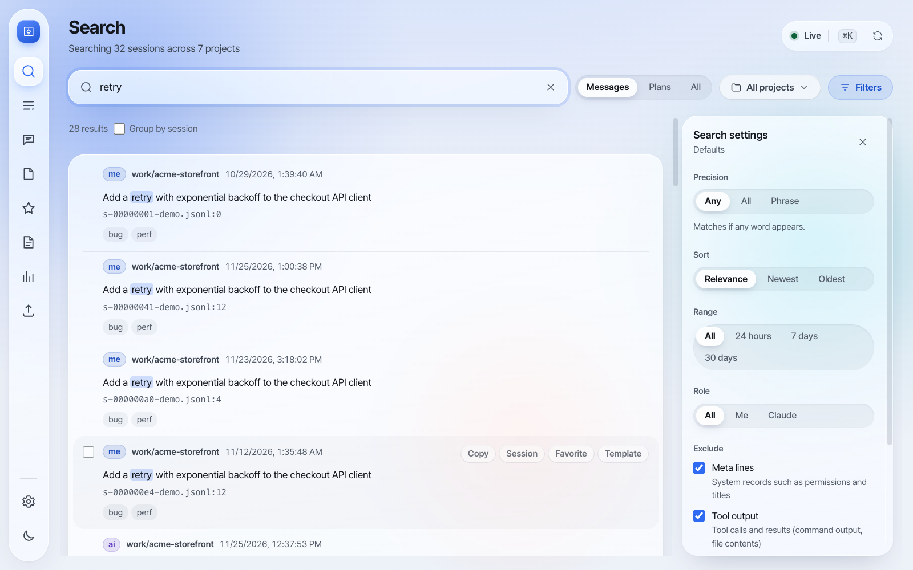
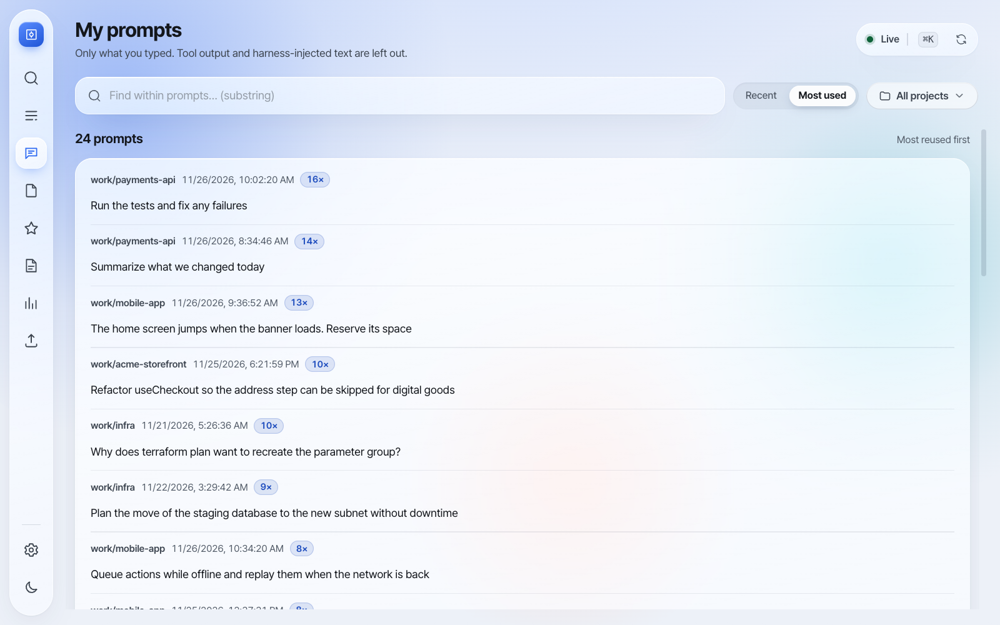
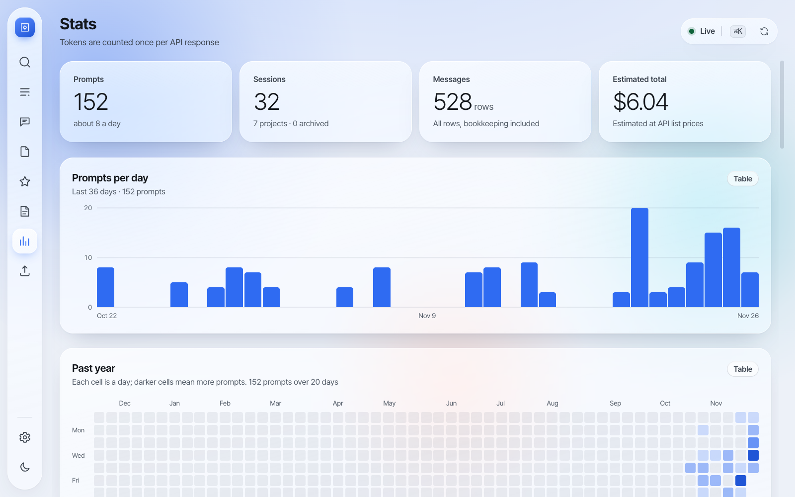
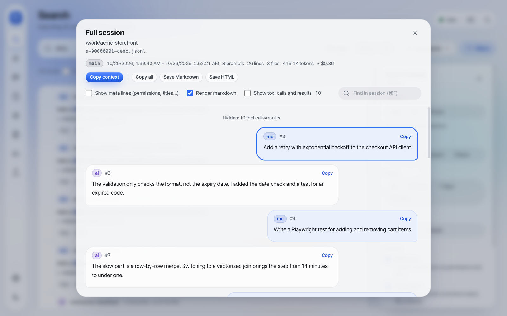
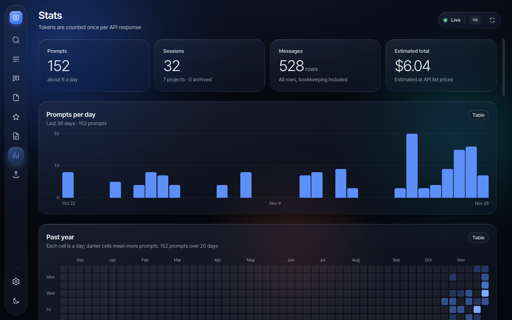
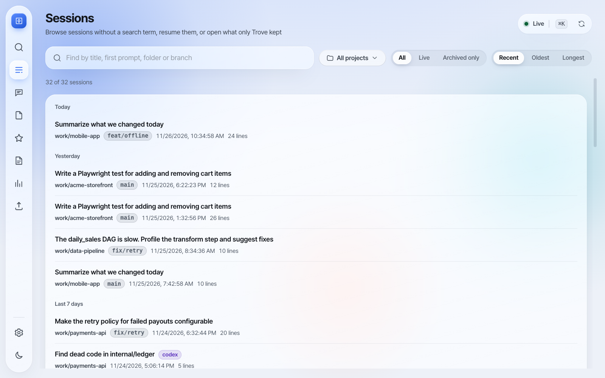
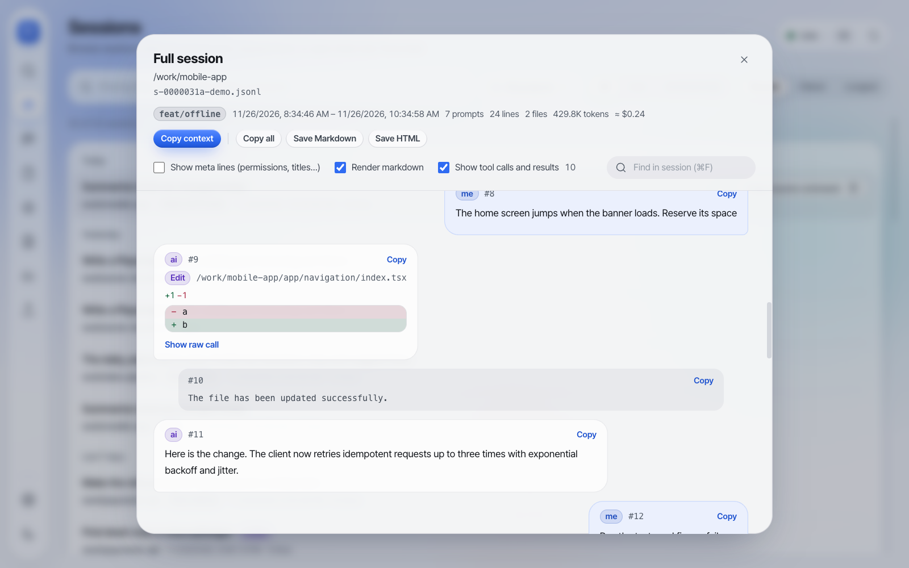

<p align="center"></p>

# Trove

[English](README.md) · [한국어](README.ko.md) · [日本語](README.ja.md) · **简体中文**

> 本文档译自英文版 [README](README.md)。如内容有出入，以英文版为准。

**Trove** 是一款在本机保存并检索 [Claude Code](https://www.anthropic.com/claude-code) 对话记录的桌面应用。

- 它为对话建立索引，即使 Claude Code 删除了旧的对话文件，也会保留副本。
- 所有记录都能以毫秒级速度搜索（SQLite FTS5），你也可以找回并重复使用自己写过的提示词。

[](https://github.com/RosieOh/trove/releases)
[](https://github.com/RosieOh/trove/actions/workflows/ci.yml)
[](LICENSE)

**[下载 macOS（Apple Silicon / Intel）、Windows 或 Linux 版 →](https://github.com/RosieOh/trove/releases)**

<picture>
  <source media="(prefers-color-scheme: dark)" srcset="docs/images/search-dark.png">
  
</picture>

- **隐私**
  - 对 Claude 的文件只读，绝不会在 `~/.claude/` 下写入任何内容。
  - 索引和备份保存在用户数据目录下的本地 SQLite 数据库中。
  - 为了衡量 Trove 是否真的有用，它会在同一数据库中只记录你打开应用的*日期*（不含时间和内容），并显示在统计页中。任何数据都不会离开本机。
  - 唯一的网络请求是向 GitHub Releases 检查是否有新版本。它不发送任何对话数据，并且可以在 **设置** 中关闭（[ADR-0005](docs/decisions/0005-update-check-network-exception.md)）。
- **支持平台：** 主要面向 macOS（Apple Silicon 和 Intel）。Windows 和 Linux 版本也在 CI 中通过了同样的端到端测试，但日常使用较少。
- **界面语言：** 目前仅支持韩语和英语（暂无中文界面）。
- **许可证：** MIT，见 [LICENSE](LICENSE)。

## 安装

从 [Releases](https://github.com/RosieOh/trove/releases) 下载适合你系统的文件。安装包**尚未进行代码签名**，因此首次启动时需要多确认一次。

**macOS：** `Trove-<版本>-mac-arm64.dmg`（Apple Silicon）或 `…-mac-x64.dmg`（Intel）。

1. 打开 DMG，把 **Trove** 拖到「应用程序」文件夹。
2. 启动一次，macOS 会提示无法验证开发者，点击 **完成**。
3. 打开 **系统设置 → 隐私与安全性**，在「已阻止使用 "Trove"」旁边点击 **仍要打开**。在 macOS 14 及更早版本中，改为右键点击应用并选择 **打开**。
4. 也可以在终端中运行：`xattr -dr com.apple.quarantine "/Applications/Trove.app"`。

未签名的 macOS 版本无法自动更新，新版本请到 Releases 页面下载。

**Windows：** 运行 `Trove-<版本>-win-x64.exe`。如果 SmartScreen 提示「Windows 已保护你的电脑」，请选择 **更多信息 → 仍要运行**。它会安装到当前用户下。

**Linux：** 任选一种安装包。
- AppImage：`chmod +x Trove-*.AppImage && ./Trove-*.AppImage`
- Debian/Ubuntu：`sudo apt install ./Trove-*.deb`

**首次运行：**
- Trove 会读取 `~/.claude/projects` 和 `~/.claude/plans`。如果你使用 Codex CLI，还会读取 `~/.codex/sessions`。
- 索引在后台线程中进行，窗口不会卡住。5 GB 的记录大约需要一分钟，之后只读取新增的行。
- 如需读取其他位置，请把 `CLAUDE_HOME` / `CODEX_HOME` 设置为绝对路径。

## 截图

| 我的提示词：只显示你亲自输入的内容，按使用次数排序 | 统计：每个 API 响应只计一次的 token、费用，以及打开 Trove 的日子 |
|---|---|
|  |  |
| **完整会话**：整段对话，工具输出折叠显示 | **深色主题** |
|  |  |
| **会话**：全部会话按最新排序，一键继续 | 工具修改的 **差异视图** |
|  |  |

截图使用的是虚构的演示记录（`scripts/demo-corpus.mjs`），可以用 `npx vite build && node scripts/screenshots.mjs` 重新生成。

## 功能

| 领域 | 状态 |
|------|------|
| 为 `~/.claude/projects`（根目录的 `{uuid}.jsonl`、`subagents/`、`agent-transcripts/`、`sessions-index.json`）和 `~/.claude/plans` 建立索引 | 支持 — 只读取追加部分，在后台 worker 中运行 |
| **归档**：Claude Code 删除的会话仍可搜索（标记为「Archived」）；只有明确操作才会删除 | 支持（默认开启） |
| 全文搜索 + 项目、角色、日期、元数据、子代理、**工具输出**、**标签** 筛选 | 支持 |
| 匹配模式（OR / AND / 短语）、排序（相关度 / 最新 / 最早），词中间或中日韩文字回退为子串匹配 | 支持 |
| **我的提示词**：只显示亲自输入的内容，去重，按最近或使用次数排序 | 支持 |
| **文件**：哪些会话在何时、在哪个分支上改动过某个文件 | 支持 |
| 重新索引或升级后也不会丢失的收藏和标签 | 支持 |
| 会话记录窗口（Markdown、元数据与工具输出开关、归档提示） | 支持 |
| 支持 `{{变量}}` 的提示词模板 | 支持 |
| 命令面板（⌘/Ctrl+K），键盘浏览结果 | 支持 |
| 统计：每周打开 Trove 的天数（路线图中决定是否继续的指标） | 支持 |
| 按模型统计用量，**每个 API 响应只计一次**；考虑 5 分钟 / 1 小时缓存写入的费用估算，以及标注日期、可编辑的价格表（Claude 与 Codex 使用的 OpenAI 模型） | 支持 |
| 导出 Markdown / CSV — 复制或保存为文件 | 支持 |
| **备份**：每天一份数据库快照，并在升级、清除归档和恢复之前各做一份；可在设置中恢复；无法打开的数据库会自动从最新备份恢复 | 支持（保留 3 份） |
| 设置：归档方式、备份、更新检查、数据位置、全部重新读取 | 支持 |
| **Claude Code 连接（MCP）**：只读的本地服务器，让 Claude Code 直接搜索你的历史，包括它已删除的会话（设置中提供 `claude mcp add` 命令） | 支持 |
| **会话**：按项目列出全部会话，最新 / 最早 / 最长排序，仅看归档，显示 `/rename` 或 Claude Code 生成的标题，按日期分组，支持键盘操作 | 支持 |
| **继续会话**：复制 `claude --resume`（或 `--fork-session`）命令；无法继续的会话可复制上下文给新会话 | 支持 |
| 会话视图：分段加载不限行数、会话内查找（⌘F）、令牌与费用、子代理链接、保存为 Markdown / HTML | 支持 |
| 工具修改文件的 **差异视图**（会话视图和文件页） | 支持 |
| 搜索运算符：`project:` `branch:` `role:` `tag:` `after:` `before:` `is:archived` `/正则/`；按会话分组；加载更多 | 支持 |
| 复制、导出（及 MCP 结果）中的 **密钥遮盖**，默认开启 | 支持 |
| 全局快捷键、归档通知 | 支持（快捷键默认关闭） |
| 统计：一年活动热力图、星期×小时、按项目费用、工具使用与错误率、5 小时区块 | 支持 |
| Codex CLI 会话（`~/.codex/sessions`，按工作目录分组） | 尽力支持 |
| 韩语 / 英语界面，浅色 / 深色主题 | 支持 |

## 文档

请查看 [docs/](docs/README.md) 目录（PRD、架构、ADR、路线图、发布流程）。文档为英文。

[CHANGELOG.md](CHANGELOG.md) — 各版本的变更。

## 开发

```bash
npm install
npm run dev
```

如需在开发时自动打开 DevTools，请使用下面的命令（Chromium 会在终端输出少量无害的日志）：

```bash
VAULT_OPEN_DEVTOOLS=1 npm run dev
```

否则可以通过 **视图 → 开发者工具** 菜单或 macOS 上的 **⌥⌘I** 打开。在 VS Code 终端或代理中运行时，请先取消设置 `ELECTRON_RUN_AS_NODE`（`env -u ELECTRON_RUN_AS_NODE npm run dev`）。

其他脚本：

- `npm run build` — 类型检查、Vite 生产构建，并用 `electron-builder` 生成安装包
- `npm run typecheck` — 检查 main/preload/shared 和渲染进程的类型
- `npm run lint` — ESLint（flat config）
- `npm test` — 单元测试（解析器、搜索辅助函数、价格计算、IPC 输入校验）
- `npm run test:db` — SQLite 集成测试（索引、归档、迁移、搜索、备份）
- `npm run test:e2e` — 端到端冒烟测试：用测试用的对话记录启动已构建的应用（先运行 `npx vite build`），并用 Playwright 操作
- `npm run bench -- <vault.db>` — 在现有索引上测量搜索延迟
- `npm run poc` — 扫描对话记录并输出解析统计的命令行工具（无界面、无数据库）

环境变量：`CLAUDE_HOME`、`CODEX_HOME`（绝对路径）、`VAULT_USER_DATA`（把索引数据库放到可以随时删除的位置）、`VAULT_DISABLE_UPDATER=1`。

每次 push 和 PR，CI（GitHub Actions）都会运行：
- 类型检查、lint、单元测试、数据库集成测试和渲染进程构建
- 在 macOS、Windows 和 Linux 上的端到端冒烟测试

## 参与贡献

请先阅读 [CONTRIBUTING.md](CONTRIBUTING.md)。错误报告和想法请提交到 **GitHub Issues**；需要长期保留的决定记录在 `docs/decisions/` 或 [docs/issue-decisions.md](docs/issue-decisions.md) 中。

## 免责声明

Trove 是一款独立的开源工具。
- 它与 Anthropic 没有任何关联，也未获得 Anthropic 的认可。「Claude」和「Claude Code」是 Anthropic 的商标，本文仅用它们来说明本应用配合什么使用。
- 应用只读取 Claude Code 已经保存在你电脑上的文件。为工作仓库建立索引时，请遵守所在组织的安全政策。
- 费用是根据记录的 token 数和可由用户编辑的价格表计算出的估算值，并非实际账单金额。
